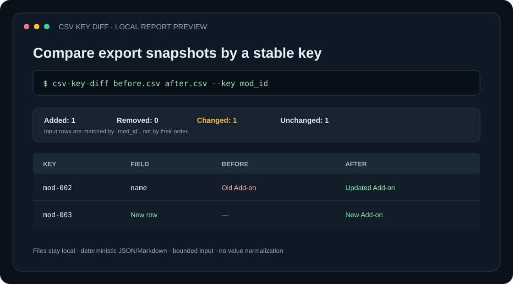

# CSV Key Diff

[](https://github.com/GhosTnever-lkm/csv-key-diff/actions/workflows/ci.yml) [](https://github.com/GhosTnever-lkm/csv-key-diff/releases) [](LICENSE)

Compare two CSV exports by a stable, unique key. See exactly which records were added, removed, or changed—and which fields changed—without loading the files into a spreadsheet or uploading them to a service.

**Useful for:** reviewing game/mod catalog exports, localization tables, inventory snapshots, and periodic operational CSV exports.



## What it checks

- Matches rows by a chosen key column, regardless of row order.
- Reports added/removed keys and field-level changes for shared keys.
- Accepts reordered headers, but clearly rejects schema drift, duplicate headers/keys, blank keys, and malformed rows.
- Writes deterministic JSON or Markdown; Markdown safely escapes untrusted cell markup.
- Uses local files only, with a default 10 MiB limit per input. It does not upload, rewrite, or redact CSV content.
- `--fail-on-changes` returns exit code `1` when changes exist, so CI can require review.

It compares values as text; it does not infer numeric/date equivalence, normalize whitespace, or decide whether a change is correct.

## Install and run

Requires Python 3.11 or later. No runtime dependencies.

```bash
python -m venv .venv
# Linux/macOS
. .venv/bin/activate
# Windows PowerShell: .venv\Scripts\Activate.ps1
python -m pip install .
csv-key-diff examples/before.csv examples/after.csv --key id
```

Create a JSON report and use the CI exit code:

```bash
csv-key-diff old.csv new.csv --key mod_id --format json --output report.json --fail-on-changes
```

A changed result exits `1` only when `--fail-on-changes` is set. Invalid input exits `2`; a valid report otherwise exits `0`.

## Example

```text
# CSV Key Diff report

Key column: `id`

Added: **1** · Removed: **0** · Changed: **1** · Unchanged: **1**

## Added rows

Keys: `mod-003`

## Changed fields

| Key | Field | Before | After |
| --- | --- | --- | --- |
| mod-002 | name | Old Add-on | Updated Add-on |
```

The full example inputs are in [`examples/`](examples/). Download the versioned source archive from [Releases](https://github.com/GhosTnever-lkm/csv-key-diff/releases/latest).

## Development and tests

```bash
python -m unittest discover -s tests -v
python -m csv_key_diff.cli examples/before.csv examples/after.csv --key id --format json
```

## ☕ Support / Pro Version

The core is free and open source under MIT. For custom CSV comparison workflows or support, open a [GitHub issue](https://github.com/GhosTnever-lkm/csv-key-diff/issues) or support the developer through [GitHub Sponsors](https://github.com/sponsors/GhosTnever-lkm). No paid product is currently offered.
